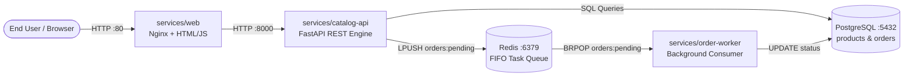

# ShopLite — Cloud-Native E-Commerce Platform

[](https://poridhi.io)
[](https://poridhi.io)
[]()

**ShopLite** is a production-style, observable, and resilient e-commerce application developed for the **Final Capstone Assessment: ShopLite on AWS (Batch 03: Mastering DevOps and AWS)**.

---

## 🏛️ System Architecture

ShopLite implements an asynchronous, event-driven decoupled architecture:



### Components
- **`services/web`**: Responsive storefront served by Nginx. Allows users to list catalog products, place orders, and track real-time order fulfillment states.
- **`services/catalog-api`**: High-performance REST API powered by Python (FastAPI). Exposes product listings, creates orders, enqueues tasks to Redis, and provides health probes (`/healthz`, `/readyz`) and Prometheus metrics (`/metrics`).
- **`services/order-worker`**: Asynchronous worker consuming from Redis list `orders:pending`. Simulates processing for 1–2 seconds, updates order states to `COMPLETED`, and terminates gracefully on `SIGTERM`.
- **`postgres`**: Relational database with automatic table creation and automatic seeding of 10 DevOps handbook products.
- **`redis`**: In-memory message broker maintaining the queue `orders:pending`.

---

## 📡 API Contract

| Method | Endpoint | Description | Status Codes |
|---|---|---|---|
| `GET` | `/products` | Return all products from PostgreSQL | `200 OK` |
| `GET` | `/products/{id}` | Return single product or 404 | `200 OK`, `404 Not Found` |
| `POST` | `/orders` | Accept `{ "product_id": 1, "quantity": 2 }`, create order, enqueue to Redis | `201 Created` (`{ "order_id": 101 }`), `422` |
| `GET` | `/orders/{id}` | Return order status (`PENDING`, `PROCESSING`, `COMPLETED`, `FAILED`) | `200 OK`, `404 Not Found` |
| `GET` | `/healthz` | Kubernetes Liveness check indicating process is alive | `200 OK` |
| `GET` | `/readyz` | Kubernetes Readiness check testing database & Redis connectivity | `200 OK`, `503 Service Unavailable` |
| `GET` | `/metrics` | Prometheus metrics endpoint | `200 OK` |

---

## 🧪 Testing

The repository includes a comprehensive unit test suite covering health probes, catalog retrieval, input validation, and order workflows:

```bash
pytest tests/ -v
```

---

## 📁 Repository Structure (Section 2.1 Deliverables)

This repository serves as the complete, self-contained implementation of all deliverables required for the **ShopLite on AWS Capstone Assessment (DEVOPS-CAP-601)**:

```text
shoplite-app/
├── services/                   # Question 1: Decoupled Microservices Source Code
│   ├── web/                    # Storefront UI (Nginx + HTML5/CSS3)
│   ├── catalog-api/            # FastAPI REST API (with /healthz, /readyz, /metrics)
│   └── order-worker/           # Async Redis queue consumer
├── docker-compose.yml          # Question 2: Local Multi-Container Orchestration & Smoke Testing
├── linux/                      # Question 3: Linux Hardening, SSH Security & Systemd Backup Timer
│   ├── setup-linux.sh          # System hardening script
│   └── sshd_config             # Hardened SSH configuration
├── terraform/                  # Question 4: Modular AWS IaC with Feature Toggle (Pure SSM / Bastion)
│   ├── modules/                # Reusable modules (network, compute, alb, ecr)
│   ├── main.tf                 # Root orchestrator with USD 20 budget Cost Guard
│   └── variables.tf            # Includes enable_ssh_bastion fallback toggle
├── ansible/                    # Question 4.g: K8s Node Bootstrapping & Cluster Initialization
│   ├── cluster-init.yml        # Calico CNI, Ingress, ArgoCD, Argo Rollouts, Local-Path StorageClass
│   └── run-ansible.sh          # Optional execution wrapper
├── helm/                       # Question 5: Production Kubernetes Helm Charts
│   └── shoplite/               # Values, templates, Argo Rollout Canary, HPA, NetworkPolicies
├── monitoring/                 # Question 6 & 8: LGTM Observability Stack & Runbooks
│   ├── dashboards/             # Grafana Golden Signals JSON dashboard
│   ├── alert-rules/            # PrometheusRule alerting & SLO burn-rate manifests
│   ├── runbooks/               # Incident runbooks & chaos-simulation.sh
│   ├── prometheus/             # kube-prometheus-stack values & ServiceMonitors
│   ├── grafana/                # Datasources (Prometheus, Loki, Tempo) & Ingress
│   ├── loki/                   # Loki & Promtail log aggregation configs
│   ├── tempo/                  # Tempo distributed tracing config
│   └── kustomization.yaml      # Declarative GitOps bundle (ConfigMaps, ServiceMonitors, Alerts, Ingress)
├── docs/                       # Architectural Evidence & Post-Mortem Documentation
│   ├── architecture-diagram.svg # End-to-end VPC & container architecture diagram
│   ├── DRY_RUN_EXECUTION_GUIDE.md # 5-hour lab execution runbook
│   ├── RCA-INCIDENT-REPORT.md  # Question 8: Incident Post-Mortem template
│   └── ARGO-ROLLOUTS-CANARY-GUIDE.md # Bonus: Progressive delivery canary guide
├── scripts/                    # Automated smoke test, load test & config validation
│   ├── smoke-test.sh           # End-to-end curl assertion suite
│   ├── load-test.py            # 25+ RPS Python load test generator
│   └── verify-workloads.py     # YAML/JSON validation harness
├── tests/                      # Automated unit test suite (pytest)
└── .github/workflows/          # Question 7: Automated CI/CD Pipeline (Trivy, Docker, ECR)
```

> **Note on GitOps Architecture:** To demonstrate enterprise-grade GitOps separation of concerns and prevent CI/CD commit-back loops, Kubernetes manifests are also maintained and synchronized with the dedicated `shoplite-gitops` repository (`https://github.com/mchowlader/shoplite-gitops`).

---

## ⚙️ Fault-Injection Flags (Chaos Engineering)

All chaos flags are disabled by default and activated via environment variables:
- `CHAOS_LATENCY_MS`: Adds artificial delay to ~30% of `GET /products/{id}` requests.
- `CHAOS_ERROR_RATE`: Returns HTTP 500 for the specified fraction of `POST /orders` requests.
- `CHAOS_MEMORY_LEAK`: Causes `order-worker` to accumulate in-memory heap per order to simulate memory leaks.
- `CHAOS_SLOW_DB`: Makes `order-worker` execute `pg_sleep(2)` before each database update.

