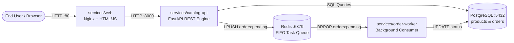

# ShopLite — Cloud-Native E-Commerce Platform

[](https://poridhi.io)
[](https://poridhi.io)
[]()

**ShopLite** is a production-style, observable, and resilient e-commerce application developed for the **Final Capstone Assessment: ShopLite on AWS (Batch 03: Mastering DevOps and AWS)**.

---

## 🏛️ System Architecture

ShopLite implements an asynchronous, event-driven decoupled architecture:



### Components
- **`services/web`**: Responsive storefront served by Nginx. Allows users to list catalog products, place orders, and track real-time order fulfillment states.
- **`services/catalog-api`**: High-performance REST API powered by Python (FastAPI). Exposes product listings, creates orders, enqueues tasks to Redis, and provides health probes (`/healthz`, `/readyz`) and Prometheus metrics (`/metrics`).
- **`services/order-worker`**: Asynchronous worker consuming from Redis list `orders:pending`. Simulates processing for 1–2 seconds, updates order states to `COMPLETED`, and terminates gracefully on `SIGTERM`.
- **`postgres`**: Relational database with automatic table creation and automatic seeding of 10 DevOps handbook products.
- **`redis`**: In-memory message broker maintaining the queue `orders:pending`.

---

## 📡 API Contract

| Method | Endpoint | Description | Status Codes |
|---|---|---|---|
| `GET` | `/products` | Return all products from PostgreSQL | `200 OK` |
| `GET` | `/products/{id}` | Return single product or 404 | `200 OK`, `404 Not Found` |
| `POST` | `/orders` | Accept `{ "product_id": 1, "quantity": 2 }`, create order, enqueue to Redis | `201 Created` (`{ "order_id": 101 }`), `422` |
| `GET` | `/orders/{id}` | Return order status (`PENDING`, `PROCESSING`, `COMPLETED`, `FAILED`) | `200 OK`, `404 Not Found` |
| `GET` | `/healthz` | Kubernetes Liveness check indicating process is alive | `200 OK` |
| `GET` | `/readyz` | Kubernetes Readiness check testing database & Redis connectivity | `200 OK`, `503 Service Unavailable` |
| `GET` | `/metrics` | Prometheus metrics endpoint | `200 OK` |

---

## 🧪 Testing

The repository includes a comprehensive unit test suite covering health probes, catalog retrieval, input validation, and order workflows:

```bash
pytest tests/ -v
```

---

## ⚙️ Fault-Injection Flags (Chaos Engineering)

All chaos flags are disabled by default and activated via environment variables:
- `CHAOS_LATENCY_MS`: Adds artificial delay to ~30% of `GET /products/{id}` requests.
- `CHAOS_ERROR_RATE`: Returns HTTP 500 for the specified fraction of `POST /orders` requests.
- `CHAOS_MEMORY_LEAK`: Causes `order-worker` to accumulate in-memory heap per order to simulate memory leaks.
- `CHAOS_SLOW_DB`: Makes `order-worker` execute `pg_sleep(2)` before each database update.
