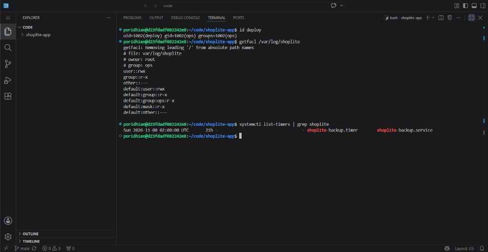

# 🛡️ Question 3: Linux Server Administration Evidence & Verification

## 1. Permission Mode 777 Rationale (Question 3.2)
> **Why mode 777 is incorrect:**  
> Using permission mode `777` (`rwxrwxrwx`) violates the Principle of Least Privilege by allowing any unprivileged user, unauthorized process, or compromised service on the host to read, modify, overwrite, or delete sensitive production logs and executable files without restriction.

---

## 2. Live Terminal Evidence Screenshot



### Verified Outputs:
1. **User `deploy` & Group `ops` (Q3.1):**
   ```text
   uid=1002(deploy) gid=1002(ops) groups=1002(ops)
   ```
2. **ACL & Permissions on `/var/log/shoplite/` (Q3.2):**
   ```text
   # file: var/log/shoplite
   # owner: root
   # group: ops
   user::rwx
   group::r-x
   other::---
   default:user::rwx
   default:group::r-x
   default:group:ops:r-x
   default:mask::r-x
   default:other::---
   ```
3. **systemd Backup Timer (Q3.3):**
   ```text
   Sun 2026-11-08 02:00:00 UTC    21h -  - shoplite-backup.timer  shoplite-backup.service
   ```

---

## 3. Evidence Verification Commands Reference

### 2.1 Users & SSH (Question 3.1)
```bash
# Verify deploy user and ops group membership
id deploy
# Expected output: uid=...(deploy) gid=...(ops) groups=...(ops)

# Verify root login refusal
ssh -o PubkeyAuthentication=no root@localhost
# Expected: Permission denied (publickey).

# Verify password login refusal
ssh -o PreferredAuthentications=password deploy@localhost
# Expected: Permission denied (publickey).
```

### 2.2 Permissions & ACL on `/var/log/shoplite/` (Question 3.2)
```bash
# Inspect standard ownership and permissions
ls -ld /var/log/shoplite

# Inspect ACL permissions with exactly one setfacl rule
getfacl /var/log/shoplite
```

### 2.3 systemd Backup Service & Timer (Question 3.3)
```bash
# Check timer schedule
systemctl list-timers | grep shoplite-backup

# Check service status after execution
systemctl status shoplite-backup.service

# Check backup artifacts
ls -lh /var/backups/shoplite/
```

### 2.4 Firewall & Port Verification (Question 3.4)
```bash
# Show listening ports
ss -tulpn

# Show UFW active rules
sudo ufw status verbose

# Test open port (HTTP 80)
curl -I http://localhost:80

# Test blocked port (e.g. Postgres 5432 or Redis 6379 from remote)
nc -zv -w 3 <SERVER_PUBLIC_IP> 5432
# Expected: Connection timed out or connection refused.
```

